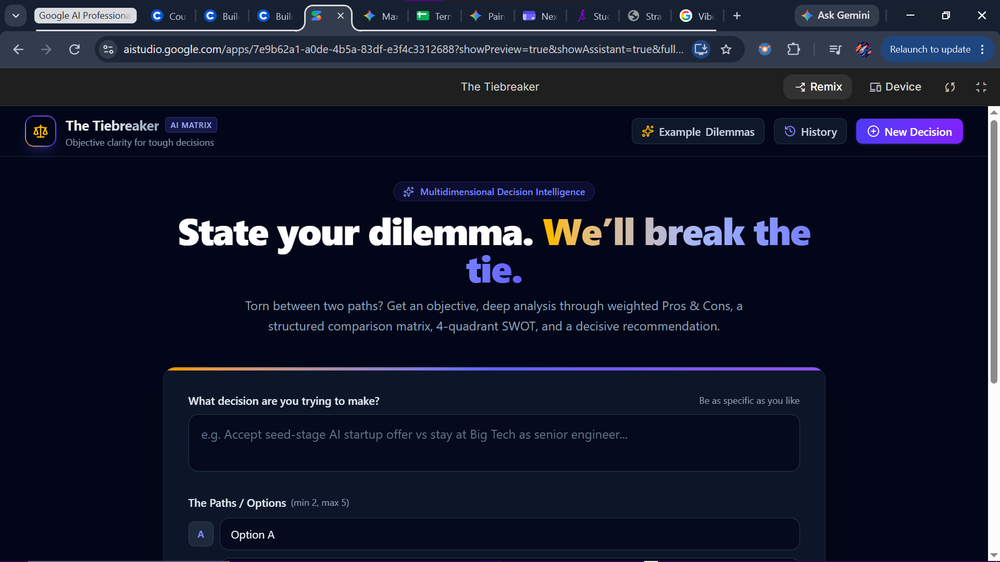
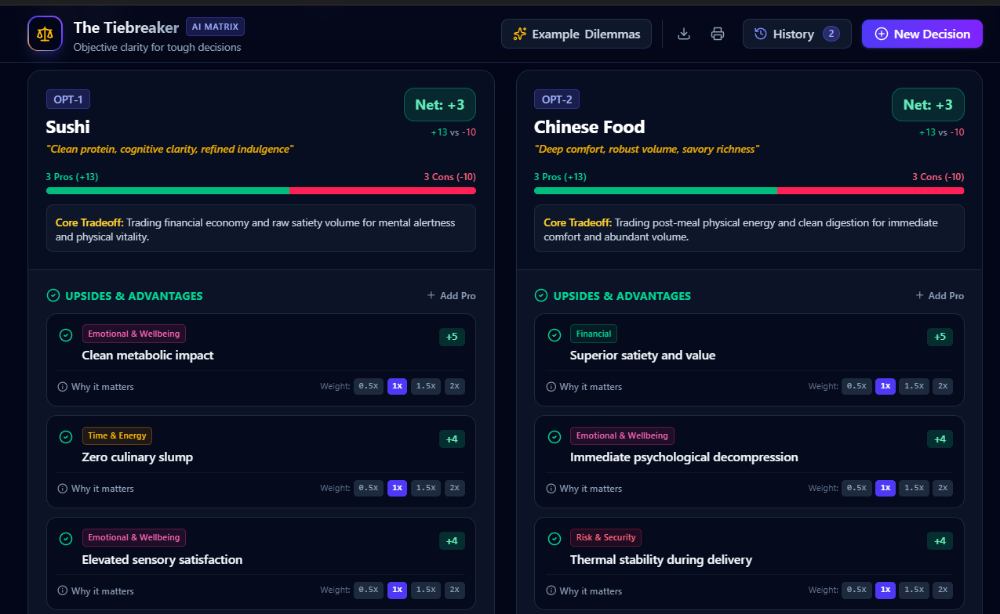
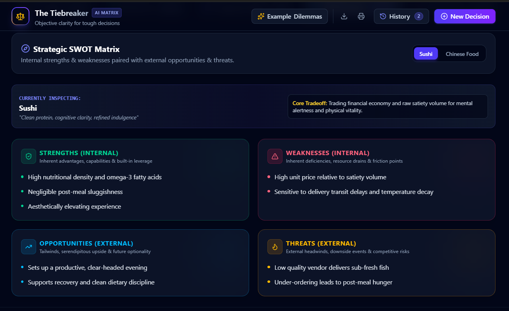
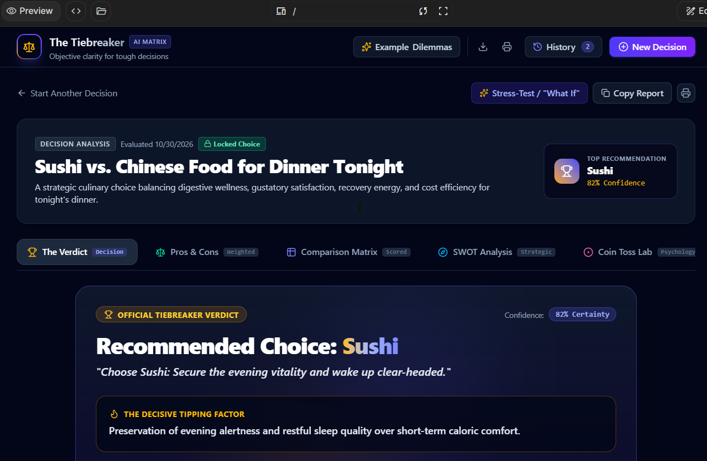

# ⚖️ The Tiebreaker

### Break the tie. Own your decision.

An AI-powered decision intelligence platform that helps you navigate difficult choices through structured analysis, intelligent recommendations, and interactive decision-making tools.

Built using **Google AI Studio** and **Gemini** as part of Google's *AI for App Building* course on Coursera.

[🚀 Try The Tiebreaker](https://ai.studio/apps/7e9b62a1-a0de-4b5a-83df-e3f4c3312688)

---

## 💡 About The Project

Making decisions can be overwhelming, especially when multiple options have competing advantages and disadvantages.

**The Tiebreaker** aims to simplify that process by turning complex dilemmas into structured, actionable insights.

Users can enter a decision, define multiple options, add personal priorities, and explore AI-assisted evaluations before committing to a choice.

The goal is simple: **Think smarter. Decide better.**

## ✨ Key Features

- **AI-Powered Decision Intake:** Describe your dilemma and explore 2–5 possible options.
- **Interactive Pros & Cons:** Evaluate advantages and disadvantages with impact ratings and customizable weights.
- **Weighted Comparison Matrix:** Compare options across multiple criteria using adjustable scoring.
- **Strategic SWOT Analysis:** Identify Strengths, Weaknesses, Opportunities, and Threats for each option.
- **AI Verdict & Recommendations:** Receive a structured recommendation, confidence score, and risk mitigation strategies.
- **Psychological Coin Toss:** Explore your subconscious preferences through an interactive coin-flip experience.
- **What-If Refinement:** Test alternative scenarios and refine your decision.
- **Decision History:** Save previous decisions and revisit your analysis.
- **Exportable Reports:** Download formatted Markdown reports of your decision analysis.

## 🛠️ Tech Stack

| Technology | Purpose |
|---|---|
| React 19 | User interface |
| TypeScript | Application development |
| Vite | Development and build tooling |
| Express | Server-side functionality |
| Google GenAI SDK | Gemini AI integration |
| Tailwind CSS 4 | Styling |
| Lucide React | Icons |
| Motion | UI animations |

## 🎯 Project Objective

To explore how Generative AI can be used beyond traditional question-answering and transformed into an interactive tool for structured thinking and everyday problem-solving.

## 🎓 Learning & Development

This project was developed as part of the **AI for App Building** course on Coursera by Google, using Google AI Studio.

It provided hands-on experience with:

- AI-assisted application development
- Prompt engineering
- Generative AI integration
- Interactive UI development
- Translating real-world problems into AI-powered solutions

## 📸 Screenshots

## 📸 Application Preview

### 🏠 Homepage — Decision Intake

### ⚖️ Interactive Pros & Cons

### 📊 Weighted Comparison Matrix

### 🎯 Strategic SWOT Analysis

### 🏆 The Final Verdict

## 🔮 Future Improvements

- Enhance decision personalization.
- Improve recommendation explainability.
- Add more decision-making frameworks.
- Explore additional ways to visualize decision insights.

## 🙌 Acknowledgements

- Google AI Studio for AI-assisted application development.
- Google Gemini for generative AI capabilities.
- Google and Coursera for the AI for App Building learning experience.

---

**Built with curiosity, experimentation, and a little help from AI. 💜**
